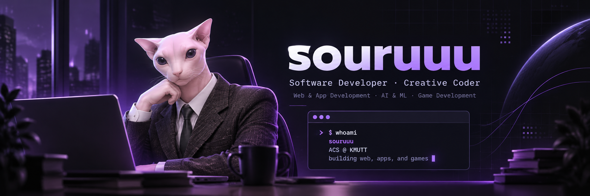

<!-- GitHub profile README for souruuu. Draft: publish only after approval. -->

  

<h1 align="center">Hi, I'm souruuu! 👋</h1>

<b>Applied Computer Science (ACS) @ KMUTT</b> · Bangkok, Thailand

Web & App Development · AI & Machine Learning · Game Development

## ✦ About Me

I'm an Applied Computer Science (ACS) student at **KMUTT**, based in **Bangkok, Thailand**.

I enjoy building software and exploring different areas of technology, from web applications to game development. Currently, I'm particularly interested in **Web & App Development** and **AI & Machine Learning**.

I also enjoy experimenting with new ideas, working on diverse projects, and participating in **hackathons and innovation competitions**.

---

## ◈ Tech Stack & Tools

### Languages & Markup

  
  
  
  
  
  
  

### Technologies & Tools

  
  
  
  
  
  
  
  
  

Currently exploring: <b>AI & Machine Learning</b>

---

## 📊 GitHub Statistics

  
  

  

Statistics are dynamically generated by third-party services and may exclude private activity. Language usage is not a measure of proficiency.

---

## ✉ Contact

**Email:** [nattasit.umph@gmail.com](mailto:nattasit.umph@gmail.com)
